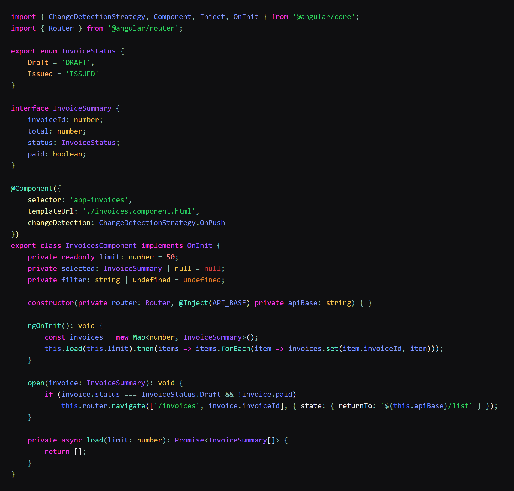
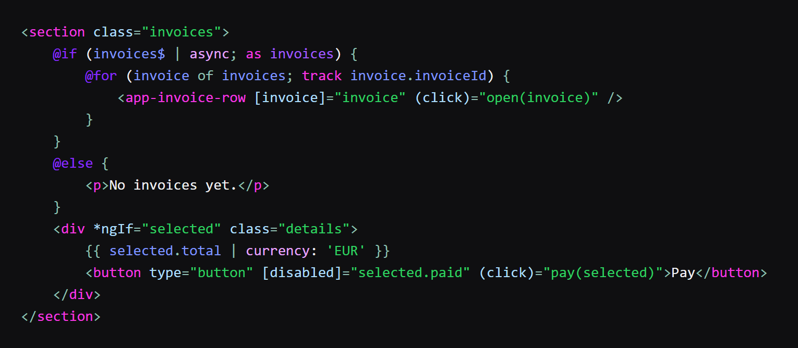
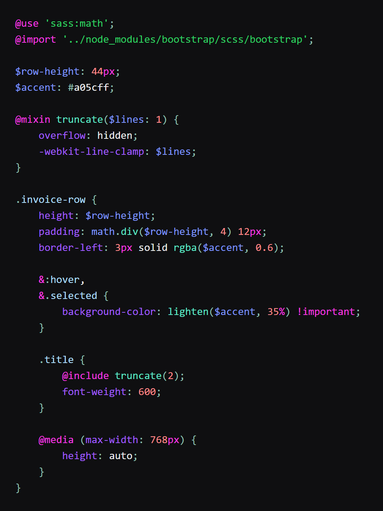

# Zoneless Night

A dark theme for Angular development.

## TypeScript



## Angular templates



## Styles



## Colours

| Token | Example | Colour |
|---|---|---|
| Keywords | `if`, `return`, `export` | magenta `#F637E3` |
| `new` | `new Map()` | bold magenta `#F637E3` |
| Classes, interfaces, types, enums | `Router`, `InvoiceSummary` | violet `#a05cff` |
| Primitive types | `string`, `number`, `void` | gold `#f5c451` |
| Variables, parameters, properties | `invoice`, `limit` | periwinkle `#7f96ff` |
| `this`, `super` | `this.router` | deep periwinkle `#5672ff` |
| Functions, methods, decorators | `navigate`, `@Component` | mint `#5ee8c6` |
| Enum members (declared) | `Draft` | amber `#ffb86c` |
| Strings | `'DRAFT'` | green `#2fd062` |
| Numbers | `50` | coral `#ff8a8a` |
| `true`, `false` | | red `#ff5c5c` |
| `null` | | dark red `#d23c3c` |
| `undefined` | | dark orange `#df7a26` |
| Structural directives | `*ngIf`, `*ngFor` | orange `#ff9a3c` |
| Control-flow blocks | `@if`, `@for`, `@switch`, `@defer` | vivid violet `#8a2bff` |
| Event bindings | `(click)` | yellow `#ffd75e` |
| Pipes | `\| async`, `\| currency` | lilac `#e7a6ff` |

Semantic highlighting is off, so decorators keep the function colour. Enum members are amber where they are
declared; where they are used they take the property colour.

## Install from source

```
npx @vscode/vsce package
code --install-extension zoneless-night-1.1.2.vsix
```

## Credits

This theme is a derivative of [Angular Gradient Dark](https://github.com/StraightRight/frontend-themes) by StraightRight.
